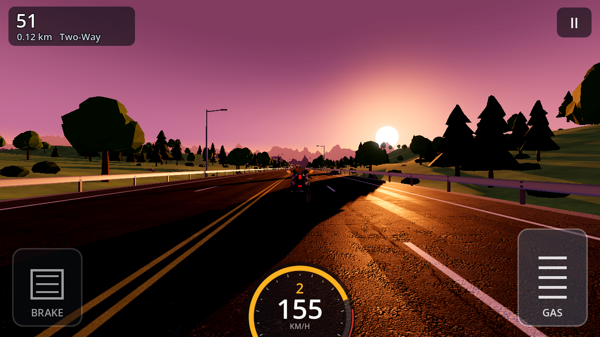
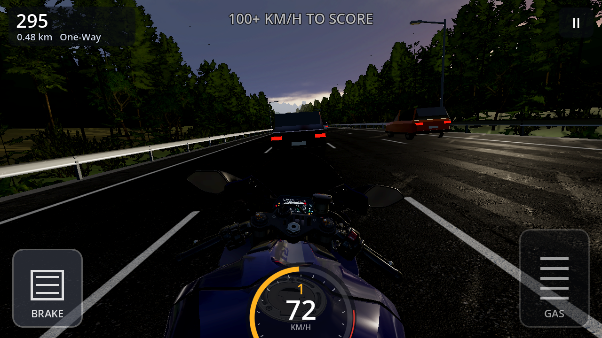
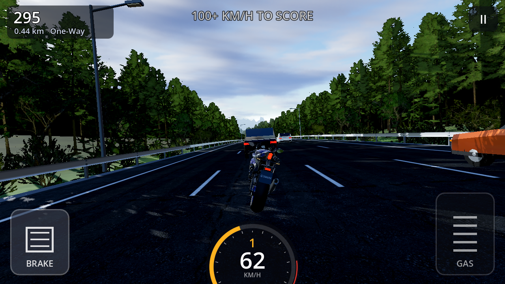
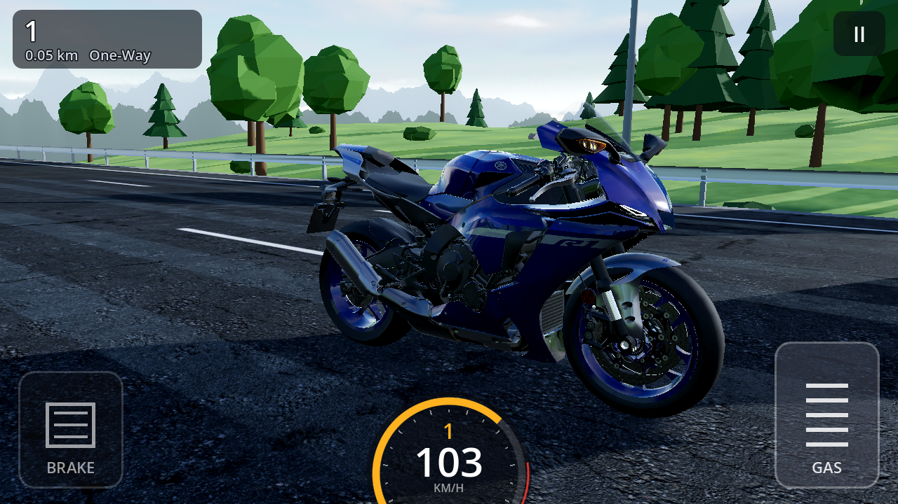

# Throttle Rush

A first-person motorcycle traffic racer for mobile, built with **Godot 4.7** (Mobile renderer,
falls back to OpenGL/Compatibility on devices without Vulkan).

Ride a superbike down an endless highway, split lanes at 300 km/h, chain near misses, and lean
into real curves. Inspired by the traffic-racer genre, with a focus on:

- **Lean-based steering.** The bike rolls with spring-damped roll dynamics and a roll-rate limit;
  the path curvature comes from the lean angle (`κ = g·tanφ / v²`), so lane changes have the
  natural lean-in / lean-out feel and you lean through actual bends in the road.
- **Steering assist** (default): your input chooses where you want to go, the bike works out the lean,
  and it leans through bends by itself. **Pro mode** (assist off): your input is the lean angle.
- **Real road**: smooth curves (clothoid-style ramps), S-bends and hills, rolling terrain, trees,
  guard rails, street lights, km signs, distant mountains.
- **Engine model**: power curve, 6-speed auto gearbox with shift cut, traction limit when leaned,
  braking that gets weaker the more you lean, drag, and road slope.
- **First-person cockpit** from the supplied 2022 Yamaha R1 model with gloved rider arms, head
  that stays more upright than the bike, speed FOV, vibration, and a chase cam with a full rider.
- **Procedural audio**: crossplane inline-4 engine (uneven 270-180-90-180° firing order) baked into
  RPM loops and cross-faded, plus wind, tyre roar, rail scrape, horns, near-miss whoosh, crash.
- **Modes**: One-Way, Two-Way (oncoming lane = x2 score), Time Trial (checkpoints add time).
  **Time of day**: Day, Sunset, Night (headlight + street-light pools) and Cloudy. Each run picks one of
  20 hand-picked cloudy sky panoramas for that time of day; the sun light, fog, ambient light and
  distant mountains are tinted from the picture so everything matches.

## Screenshots

| Cockpit | Sunset (two-way) |
|---|---|
|  |  |
| **Night** | **Cloudy** |
|  |  |
| **Day, chase cam** | **Garage** |
|  |  |

## Shiny bike

The R1 has a clear-coated metallic paint, polished aluminium/chrome parts, gold forks and real mirror
glass. On Medium/High graphics a reflection probe rides with the bike and re-captures the world every
frame, so the paint and chrome reflect the actual road, trees, traffic and sky (the bike is on its own
render layer, so it doesn't reflect itself). Low graphics falls back to sky-only reflections.



## Forest road

The roadside is a dense forest built from Poly Haven plants (fir trees, young firs and pines, a
broadleaf tree, island tree, searsia bush, shrubs and ferns). Those models are millions of triangles
each, so they are baked offline into **impostors**: each plant is rendered from 8 directions into one
2048x4096 colour + normal atlas (`assets/vegetation/`). In game every plant is a 2-triangle card that
turns to face the camera, picks the nearest baked view, is lit through its normal map, sways a little
in the wind, and casts shadows. A road chunk's whole forest (~130 plants: a fern/shrub band, then three
staggered tree rows) is **one draw call**, with a dark forest-interior band behind the last row so no
gaps show open land. Graphics quality scales the density (Low 55 %, Medium 85 %, High 100 %).

Re-bake (needs the source glTFs from Poly Haven in a folder, and a real renderer, e.g. under xvfb):
`godot --path . -- --bake-vegetation=/path/to/polyhaven_models`

## Garage

Cash earned from runs buys **Engine**, **Brakes** and **Handling** upgrades (5 levels each), and the
bike can be repainted (the paint shader only recolours the blue livery, so decals stay intact).
Test flags: `--cash=N`, `--paint=N`, `--menu --garage --shot=PATH`.

## Controls

| | Phone | Keyboard (desktop testing) |
|---|---|---|
| Steer / lean | Tilt the phone like a steering wheel (or on-screen arrows in *Settings → Steering: Touch*) | A / D or ← → |
| Throttle | GAS pedal (bottom right) | W or ↑ |
| Brake | BRAKE pedal (bottom left) | S or ↓ |
| Camera | Pause menu | C |
| Pause | II button | Esc / P |

Scoring starts above 100 km/h and scales with speed. Near misses (passing a car with < 1 m gap at
80+ km/h) give bonus points and build a combo.

## Project layout

```
scenes/          main_menu.tscn, game.tscn (thin; everything is built in code)
scripts/
  game.gd        autoload: settings, save file, dev flags
  game_world.gd  gameplay scene: world setup, game loop, scoring, autopilot/test harness
  rider.gd       bike physics (road/Frenet coordinates), cameras, crash
  bike_visual.gd loads the R1 glTF, splits the wheels so they spin, lean/brake light
  rider_arms.gd  first-person arms + gloves;  rider_body.gd  full rider for chase cam/crash
  road.gd        curvature/elevation program, road<->world mapping, chunk streaming, scenery
  props.gd       procedural trees, rocks, street lights, signs
  traffic.gd     traffic spawning, car-following, lane changes, near-miss/crash detection
  car_factory.gd procedural car/SUV/van/truck meshes (lofted cross-sections)
  hud.gd         HUD, pedals, tilt input, pause and game-over panels
  bike_audio.gd  procedural audio synthesis + playback
  main_menu.gd   showroom menu, settings
shaders/         road (scanned asphalt + markings), terrain, mountain backdrop, showroom floor, speed lines
assets/bike/     supplied model (see license.txt)
assets/audio/    pre-baked engine loops (regenerate with --bake-audio)
```

## Dev / test flags

Pass after `--` on the command line (read via `OS.get_cmdline_user_args()`):

| Flag | Effect |
|---|---|
| `--fresh` | ignore the save file |
| `--nosave` | don't write the save file |
| `--game` | skip the menu, start riding |
| `--autotest` | autopilot rides (dodges traffic, brakes, takes bends); prints a status line every 5 s, restarts after crashes |
| `--until=N` | stop the autotest after N simulated seconds (across restarts) |
| `--shot=PATH` (`--at=T`) | save a screenshot at game time T (default 6 s) and quit; uses the autopilot unless `--noauto` |
| `--shots=DIR` (`--times=a,b,c`) | save screenshots at several times, then quit |
| `--menu --shot=PATH` (`--settings`) | screenshot the main menu (or settings) |
| `--mode=0/1/2` | One-Way / Two-Way / Time Trial |
| `--time=day/sunset/night/cloudy` | time of day |
| `--sky=N` | force a specific sky panorama (see `scripts/sky_library.gd`) |
| `--view=fp/chase` | camera |
| `--seed=N` | road + traffic seed |
| `--touch` | on-screen steering buttons instead of tilt |
| `--quality=0/1/2` | graphics quality |
| `--photo` | close 3/4 camera riding alongside the bike (for screenshots) |
| `--audiotest` | render every procedural sound offline, check samples are finite, print peak/RMS |
| `--bake-vegetation=DIR` | bake the roadside plant impostor atlas from Poly Haven glTFs in DIR |
| `--bake-audio` | re-bake the engine loops into `assets/audio/` |

Examples:

```bash
# Fast logic check (no rendering):
godot --headless --path . --fixed-fps 60 -- --fresh --nosave --autotest --until=120

# Screenshot on a virtual screen (software Vulkan / OpenGL):
xvfb-run -a -s "-screen 0 1280x720x24" godot --path . --rendering-method mobile \
  --resolution 1280x720 --fixed-fps 20 -- --fresh --nosave --seed=5 --shot=/tmp/out.png --at=8
```

## Building for Android

1. Install the Godot 4.7 Android export templates and set up the Android SDK/JDK in the editor.
2. `export_presets.cfg` contains an arm64 Android preset (landscape, immersive, vibrate permission).
   Add your keystore in *Project → Export*.
3. Export, install, and **calibrate**: tilt steering takes the phone's position at the start of a
   run (and when resuming from pause) as neutral.

## Credits

- Motorcycle model: "2022 Yamaha R1" by Hari on Sketchfab, Sketchfab Standard license
  (`assets/bike/license.txt`).
- Road surface: "Asphalt 02" by Rob Tuytel, [Poly Haven](https://polyhaven.com/a/asphalt_02), CC0
  (4K colour, normal and AO/roughness maps in `assets/textures/asphalt_02/`).
- Vegetation: fir_tree_01, fir_sapling, pine_sapling_small, tree_small_02, island_tree_02,
  searsia_lucida, shrub_02, fern_02 from [Poly Haven](https://polyhaven.com/models), CC0 (baked to impostors).
- Skies: "Cloudy Skyboxes" by Screaming Brain Studios, CC0 (`assets/skies/`).
- Everything else (lane markings, scenery, cars, audio, UI) is procedural.
