# Throttle Rush

A first-person motorcycle traffic racer for mobile, built with **Godot 4.7** (Mobile renderer,
falls back to OpenGL/Compatibility on devices without Vulkan).

Ride a superbike down an endless highway, split lanes at 300 km/h, chain near misses, and lean
into real curves. Inspired by the traffic-racer genre, with a focus on:

- **Lean-based steering.** The bike rolls with spring-damped roll dynamics and a roll-rate limit;
  the path curvature comes from the lean angle (`κ = g·tanφ / v²`), so lane changes have the
  natural lean-in / lean-out feel and you lean through actual bends in the road.
- **Steering assist** (default): your input chooses where you want to go, the bike works out the lean,
  and it leans through bends by itself. **Pro mode** (assist off): your input is the lean angle.
- **Real road**: smooth curves (clothoid-style ramps), S-bends and hills, rolling terrain, trees,
  guard rails, street lights, km signs, distant mountains.
- **Engine model**: power curve, 6-speed auto gearbox with shift cut, traction limit when leaned,
  braking that gets weaker the more you lean, drag, and road slope.
- **Three bikes** (Garage): Yamaha YZF-R1 (balanced), Kawasaki Ninja H2 (supercharged, fastest,
  heaviest) and Kawasaki Ninja ZX-6R (lightest, sharpest steering, screaming 16,000 rpm redline). Each
  has its own power, weight, drag, gearing, redline, lean limit and handling, a live dash scaled to its
  rev range, working mirrors, pivoting levers and its own rider contact points.
- **First-person cockpit** with gloved rider arms, head that stays more upright than the bike, speed
  FOV, vibration.
- **Procedural audio**: crossplane inline-4 engine (uneven 270-180-90-180° firing order) baked into
  RPM loops and cross-faded, plus wind, tyre roar, rail scrape, horns, near-miss whoosh, crash.
- **Modes**: One-Way, Two-Way (oncoming lane = x2 score), Time Trial (checkpoints add time).
  **Time of day**: Day, Sunset, Night (headlight + street-light pools) and Cloudy. Each run picks one of
  20 hand-picked cloudy sky panoramas for that time of day; the sun light, fog, ambient light and
  distant mountains are tinted from the picture so everything matches.

## Screenshots

| Cockpit | Sunset (two-way) |
|---|---|
| 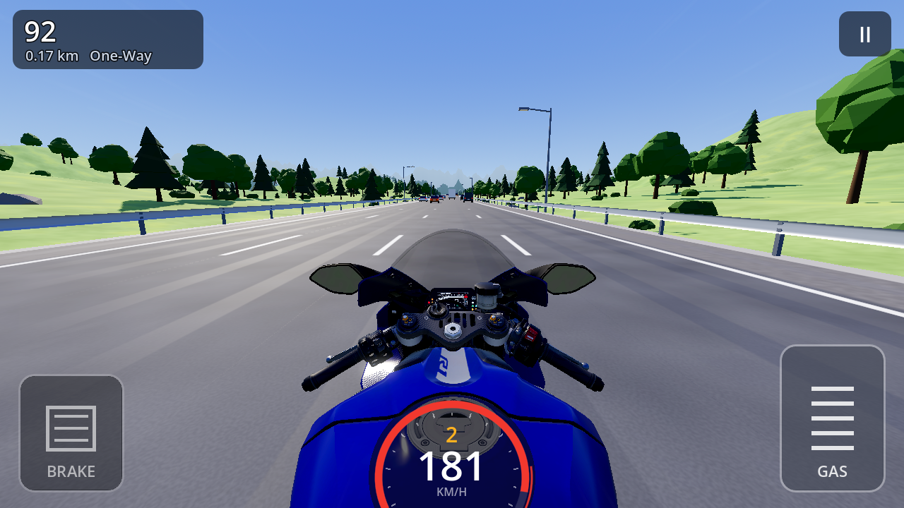 |  |
| **Night** | **Cloudy** |
| 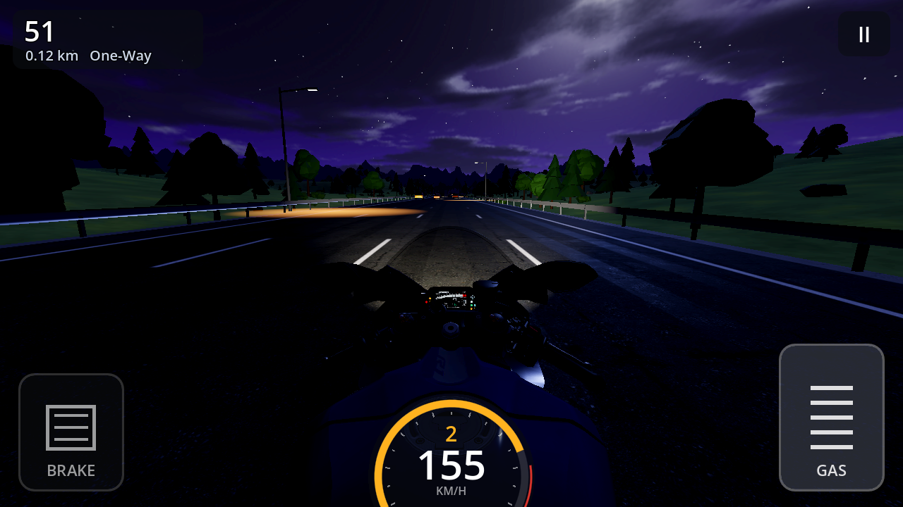 |  |
| **Day, chase cam** | **Garage** |
|  | 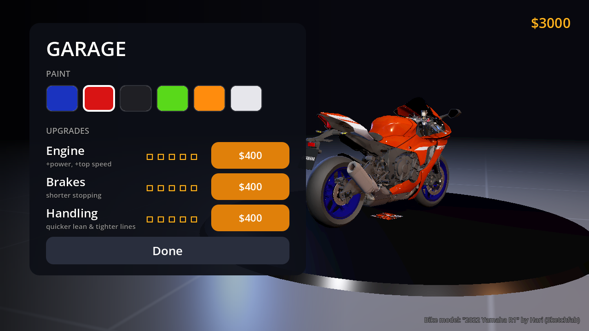 |

## Rain mode

Toggle **Weather: Rain** in the menu (any time of day; `--rain` on the command line).

- **Wet road with real-time reflections:** a second camera renders the scene mirrored about the road
  surface under the bike (half resolution on High, a third and every other frame on Medium). The road
  shader blends it in by Fresnel: sharp in puddles, blurred and streaked vertically on soaked asphalt,
  distorted by animated raindrop ripples. Puddles collect in the worn tyre ruts; asphalt darkens, paint
  less so. Low graphics uses sky reflections only.
- **Rain:** streak particles stretched along the rain's velocity *relative to you*, so they rake
  towards you at speed; splashes on the road ahead; spray off the rear tyre.
- **Simulated water drops** (`scripts/drop_sim.gd`): rain on the visor and the bodywork is a particle
  simulation — beads land, touching drops merge (volume conserved), heavy drops run with stick-slip
  motion, shed trails of tiny droplets and sweep up beads; wind takes over with speed. Drops render into
  a water map (normal + thickness) that the visor/bike shaders use for lens refraction and highlights.
- **Visor drops (first person):** drops bead on the helmet visor, refract the view, and get blown
  outwards/upwards by the airflow as you speed up (slide down when slow).
- **Wet bike and rider:** every surface gets a glossier clear coat, plus an overlay pass of water
  droplets placed in the bike's own space (they stick to it); a share of them run down and get blown
  backwards faster with speed.
- **Lights in the rain:** street lights switch on (warm sodium with some cool LED ones), every lamp and
  every car head/tail light gets a glowing halo, and brake lights flare. These are in the reflection too,
  so on the wet road each light becomes a long vertical streak (multi-tap smear towards the viewer,
  longer at grazing angles, with a fake-HDR boost so bright lights glow and bloom).
- **Atmosphere:** overcast skies, soft overhead light without hard shadows, grey mist, headlight and car
  lights on, rain and tyre-hiss audio, and ~22% less grip (braking, acceleration, cornering).

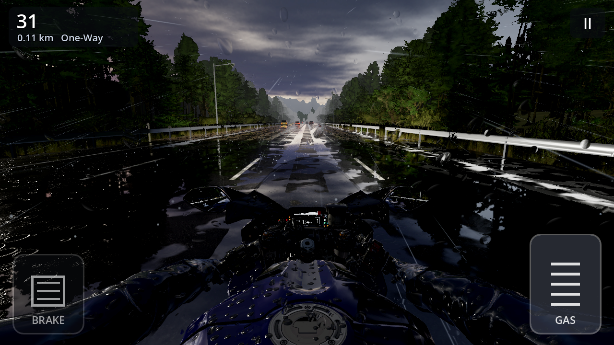
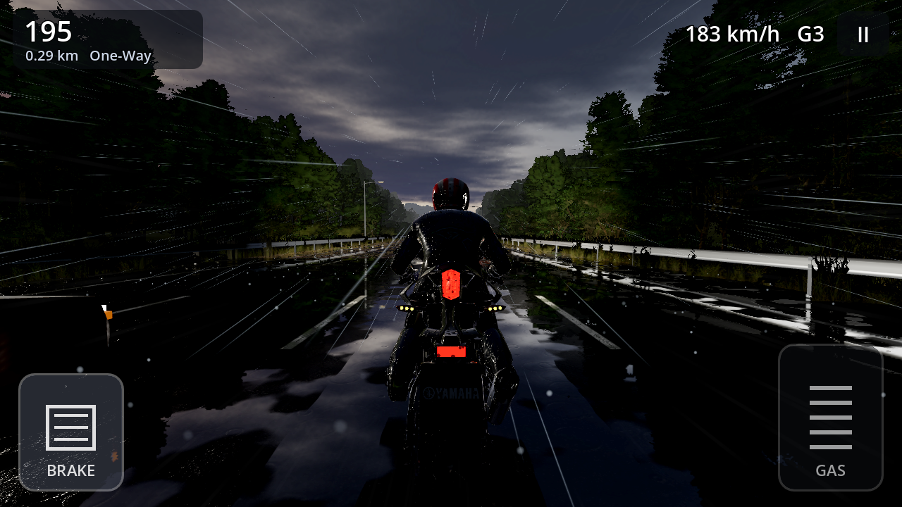
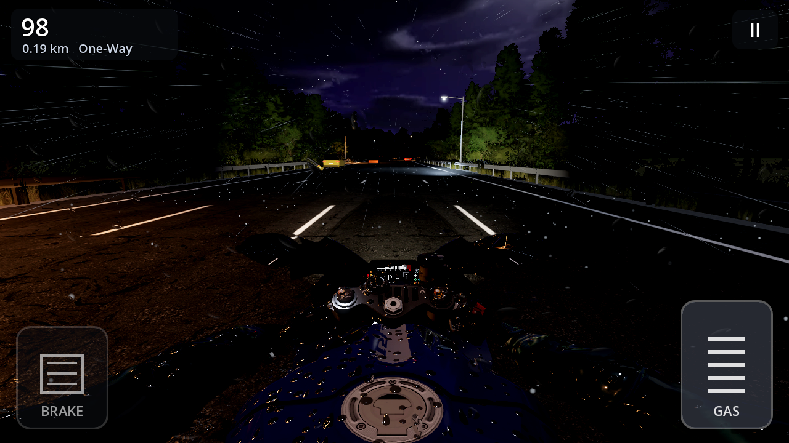

## Bikes

`scripts/bike_defs.gd` holds one entry per bike: performance, how to normalise the model (rotation,
scale, ground offset), which meshes are the wheels / mirrors / lights / glass, material finishes, and
the rider contact points (grips, brake lever, footpegs, seat). The contact points were measured on
each mesh from orthographic renders with a 5 cm grid. `BikeVisual` builds any bike from its entry:
the wheels are re-parented to spinning hubs, the brake and clutch levers are cut out of the mesh so
they pivot, the mirror glass (the rear-facing triangles on the mirror heads) shows a live rear camera,
and a live TFT dash is placed on the instrument face.

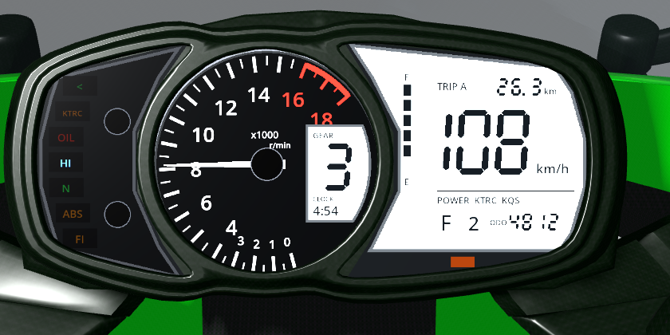

- **ZX-6R instrument cluster** (`scripts/cluster_zx6r.gd`): the real layout, with the warning-light
  column, the big analog tach (0-4k compressed along the bottom, red from 16k, silver needle), the
  GEAR/CLOCK window inside the dial, and the backlit LCD (7-segment speed with ghost segments, trip,
  odometer, fuel bar, mode line). An amber shift lamp flashes at the redline. It is drawn into a
  texture and projected flat onto the model's own three dash faces; the warning panel, LCD window and
  gear window are drawn to the exact outlines of the openings, so they follow the curves of the slots in
  the cluster housing.
- **ZX-6R:** the 4K PBR texture set was reduced to 2K/1K albedo + packed roughness/metal + normal maps
  (`assets/bikes/zx6r/tex/`); the green livery is the repaintable part.
- **H2:** the model has no textures, only vertex colours, so it gets per-material finishes (mirror-black
  clear-coated paint, glossy green trellis frame, metallic engine, chrome pipes).

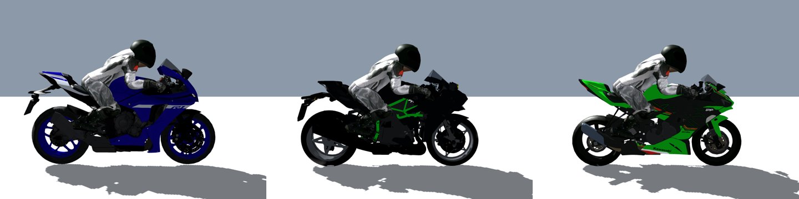
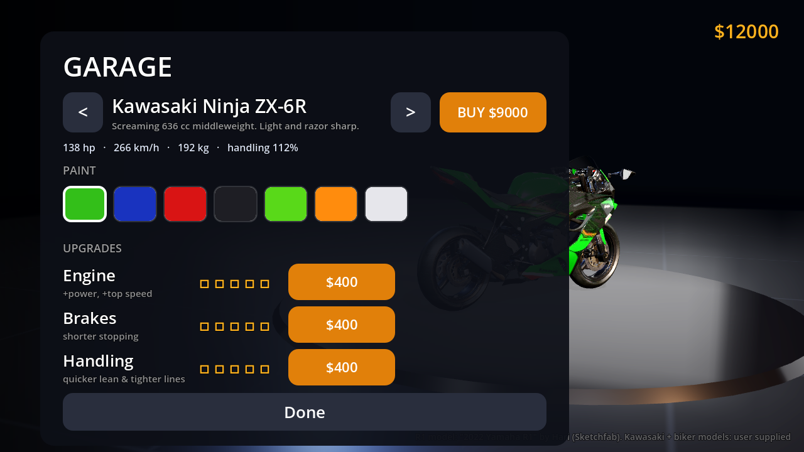

Add a bike: drop the model in `assets/bikes/<id>/`, add an entry to `BikeDefs.LIST`, and check the
contact points with `--posetest=DIR --markers --bike=<id>`.

## Rider

The rider is the leather-suited biker (`assets/rider2/Biker.glb`), posed procedurally every frame by
`scripts/rider_model.gd` against the selected bike's contact points. The solver works through a
bone-name profile, so it also drives the older Ready Player Me avatar (`--rider=rpm`). The biker has
mitten glove fingers and no toe bones; the finger tips and toes are found from the skin weights.

- **Posture:** pelvis on the seat, spine curved into a sport tuck (deeper at speed). The torso pitch is
  then solved per bike so the shoulders sit at a natural reach from that bike's bars (elbows bent).
  Neck/head are counter-rotated so the eyes stay level, looking into turns; the rider hangs off the
  inside of the bike when leaning.
- **Arms:** two-bone IK from the shoulders to the clip-ons, elbows low and out.
- **Hands:** each glove is oriented along the grip axis with the knuckles on the top-front of the bar;
  every finger joint is solved so the next joint lands on a circle hugging the grip (grip radius +
  finger thickness), so all four fingers wrap the bar and the thumb closes underneath. No floating.
- **Throttle:** the right hand rolls back around the grip (up to 30°) with the throttle.
- **Brake:** index and middle fingers lift off the grip onto the brake lever and pull it; the lever is
  cut out of the bike mesh at load time and pivots back towards the grip with brake pressure, and the
  fingers follow it. Gear shifts blip the left fingers on the (also pivoting) clutch lever.
- **Legs:** IK to the footpegs, balls of the feet on the pegs, heels up, knees forward along the tank
  (inside knee out when hanging off). The hips sit just behind the pegs, as on a real sportbike.
- **First person:** the helmet is hidden and anything within ~0.6 m of the camera is dithered away, so
  you see the rider's forearms and gloves on the bars.

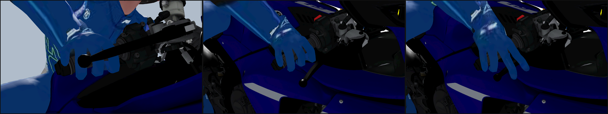
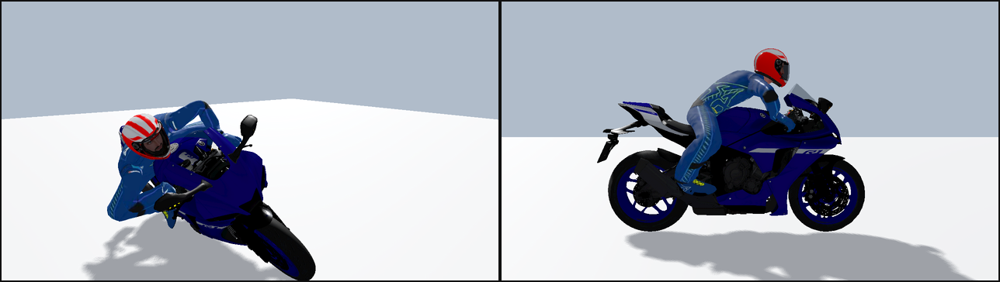

Review tool: `godot --path . res://scenes/pose_test.tscn -- --posetest=DIR` renders side/front/hand
close-ups/first-person views for cruise, full throttle, braking and leaning (`--posenum` prints joint
positions in the grip's frame, `--markers` shows the measured contact points).

## Shiny bike

The R1 has a clear-coated metallic paint, polished aluminium/chrome parts, gold forks and real mirror
glass. On Medium/High graphics a reflection probe rides with the bike and re-captures the world every
frame, so the paint and chrome reflect the actual road, trees, traffic and sky (the bike is on its own
render layer, so it doesn't reflect itself). Low graphics falls back to sky-only reflections.


## Forest road

A dense forest built from Poly Haven plants, layered so it has real volume but stays cheap on phones:

- **Trees (depth impostors).** Fir trees, young firs/pines, a broadleaf tree, island tree and searsia are
  millions of triangles each, so they are baked offline from **16 directions** into one 4096x3584
  atlas holding colour, normals and **per-pixel depth**. In game each tree is a 2-triangle card that
  turns to the camera and, per pixel: blends the two nearest views (no popping), parallax-shifts each
  view by its depth (the canopy has real depth as you ride past), lights and shadows the pixel at its
  true depth, and on High writes that depth to the z-buffer so trees intersect each other and the
  ground correctly. Species/per-tree colour variation, translucent backlighting and wind sway on top.
  All trees in a road chunk are **one draw call**.
- **Undergrowth (real meshes).** Ferns and shrubs right next to the rail are the actual Poly Haven
  meshes (2-9k triangles, auto-LOD), culled beyond 100 m.
- **Verge grass.** A strip of real Poly Haven grass tufts is baked into a texture and drawn on
  crossed cards that sway, in two thick bands along the verge.
- **Far band.** Behind the last row, staggered rows of baked fir frames over a dark interior, so gaps
  never show open land.

Graphics quality scales density (Low 55 %, Medium 85 %, High 100 % + depth writing).

Re-bake (needs the source glTFs from Poly Haven in a folder and a real renderer, e.g. under xvfb):
`godot --path . -- --bake-vegetation=DIR` and `godot --path . -- --bake-grass=DIR`

## Garage

Browse bikes with the arrows and buy the Kawasakis with cash from runs (ZX-6R $9,000, H2 $18,000).
Cash also buys **Engine**, **Brakes** and **Handling** upgrades (5 levels each), and the bike can be
repainted: Factory plus six colours (the paint shader only recolours the livery colour, so decals stay
intact; the untextured H2 gets a solid metallic paint).
Test flags: `--cash=N`, `--paint=N`, `--bike=r1|h2|zx6r`, `--menu --garage --shot=PATH`.

## Controls

| | Phone | Keyboard (desktop testing) |
|---|---|---|
| Steer / lean | Tilt the phone like a steering wheel (or on-screen arrows in *Settings → Steering: Touch*) | A / D or ← → |
| Throttle | GAS pedal (bottom right) | W or ↑ |
| Brake | BRAKE pedal (bottom left) | S or ↓ |
| Camera | Pause menu | C |
| Pause | II button | Esc / P |

| Wheelie | Roll off and snap the GAS back on in 1st/2nd below ~100 km/h; keep it pinned to hold it | same with W |

## Race feel

The rider and bike behave like a racing game, not a static model:

- **Tuck**: on fast straights (after holding the throttle for a moment) the rider slides back and
  drops flat onto the tank, head behind the screen, and stays tucked through brief throttle lifts. In the cockpit view the camera goes down with the head, and you look
  over the dash through the screen.
- **Body position in levels**, picked from the *sustained* lean (quick direction changes in traffic
  don't make the rider climb around the bike) and set up just before a real bend, as riders do:
  basic (seat centred, only the upper body leans in), intermediate (onto the inside cheek) and full
  hang-off past ~35° (off the seat, square to the bike, head and shoulders inside, inside knee out).
  Past ~45° the knee slider touches down: sparks, a quiet scrape, and the lean readout turns orange.
- **Realistic lean**: lane changes and swerves use about 20-25° of lean (the lateral acceleration a
  rider uses on the road); bends still lean as far as they need.
- **Braking**: the rider sits up out of the tuck with the arms braced; the body is pushed forward by
  the deceleration (back under acceleration). Braking hard into a bend, the inside leg comes off the
  peg and swings out and forward, and the body is set up for the corner before turn-in.
- **Looking through the corner**: the head turns towards the corner (from the road curvature ahead)
  and the helmet cam turns with it.
- **Gear shifts**: the left toe flicks up under the lever on each upshift.
- **Bike**: braking compresses the forks: the nose dives about the rear contact patch while the front
  wheel stays on the road (it rises into the fender); the fork extends again on the gas. Only at the
  very limit from high speed does the rear go light and lift a little. Braking really hard into a
  real bend makes the rear step out (backing it in) with tyre smoke and skid marks. The front brake disc glows orange after repeated hard
  stops from high speed and cools down again. Exhaust pops on shifts and on the overrun show a
  flame at the silencer.
- **Screen**: radial speed blur with a slight colour fringe above ~190 km/h (medium/high graphics),
  a lean angle readout, and an optional **Helmet view** (Settings / pause menu): the visor opening of
  a race helmet framing the screen, with a slight tunnel effect at speed.

- **Chase view**: a follow camera behind and a little above the bike on its path. Its heading follows
  the direction of travel with a short lag and the horizon stays nearly level, so the bike leans in
  the frame instead of the world tilting.

## Scoring and feel

- **Distance score** starts above 100 km/h and scales with speed.
- **Near misses**: pass a car with less than 1.3 m of side gap at 80+ km/h (riding near the lane line,
  or splitting lanes). Under 0.45 m is a **CLOSE CALL** (x1.6). Points scale with speed (up to x2.6),
  double for oncoming cars, and multiply by the **combo** (up to x10). The combo bar under the counter
  drains over 4 s; another near miss refills it, and ordinary close passes keep it alive a bit longer.
  Each near miss gives a whoosh, a vibration pulse and an FOV punch.
- **Bonus streaks** build while they last and are banked with a popup when they end: **HIGH SPEED**
  (above 200 km/h, +50%), **ONCOMING** (Two-Way, riding in the oncoming lanes, x2) and **WHEELIE**.
  The running streak is shown under the score.
- **Wheelies**: wheelie control caps the angle at 30°; steering is much lighter on one wheel; brake,
  roll off, shift past 2nd or pass ~100 km/h and the front sets down.
- **Weight and speed**: the head dips and moves forward under braking and engine braking, leans back
  under hard acceleration and nods on each upshift (with a short FOV dip and a light vibration).
  Road rumble grows with speed, a fine engine buzz with revs; the head roll lags the bike slightly.
  The FOV widens with speed (more past 220 km/h) and the wind starts buffeting past ~250 km/h.
- **Controls**: tilt has a short dead zone and a response curve (fine corrections near the centre,
  fast swerves at full tilt) with ~30 ms smoothing; reversing a lean (a flick) is quicker than leaning
  in from upright. The brake bites at 35% immediately and builds to full over ~0.25 s; the throttle
  rolls on over ~0.1 s. *Re-centre tilt* is in the pause menu.
- **Crashes**: a slow-motion moment at impact easing back to real time, the rider flails while thrown
  and goes limp on the ground, and a **RETRY** button appears straight away.
- **Traffic** uses indicators before changing lanes, honks if you cut in just ahead of it, and oncoming
  cars honk when you ride at them in their lane.

## Project layout

```
scenes/          main_menu.tscn, game.tscn (thin; everything is built in code)
scripts/
  game.gd        autoload: settings, save file, dev flags
  game_world.gd  gameplay scene: world setup, game loop, scoring, autopilot/test harness
  rider.gd       bike physics (road/Frenet coordinates), cameras, crash
  bike_defs.gd   per-bike specs, part names and rider contact points
  bike_visual.gd builds a bike: spinning wheels, pivoting levers, mirrors, dash, paint, lean/brake light
  rider_model.gd procedural rider pose (IK) on the selected bike; first-person forearms
  road.gd        curvature/elevation program, road<->world mapping, chunk streaming, scenery
  props.gd       procedural trees, rocks, street lights, signs
  traffic.gd     traffic spawning, car-following, lane changes, near-miss/crash detection
  car_factory.gd procedural car/SUV/van/truck meshes (lofted cross-sections)
  hud.gd         HUD, pedals, tilt input, pause and game-over panels
  bike_audio.gd  procedural audio synthesis + playback
  main_menu.gd   showroom menu, settings
shaders/         road (scanned asphalt + markings), terrain, mountain backdrop, showroom floor, speed lines
assets/bike/     supplied model (see license.txt)
assets/audio/    pre-baked engine loops (regenerate with --bake-audio)
```

## Dev / test flags

Pass after `--` on the command line (read via `OS.get_cmdline_user_args()`):

| Flag | Effect |
|---|---|
| `--fresh` | ignore the save file |
| `--nosave` | don't write the save file |
| `--game` | skip the menu, start riding |
| `--autotest` | autopilot rides (dodges traffic, brakes, takes bends); prints a status line every 5 s, restarts after crashes |
| `--until=N` | stop the autotest after N simulated seconds (across restarts) |
| `--shot=PATH` (`--at=T`) | save a screenshot at game time T (default 6 s) and quit; uses the autopilot unless `--noauto` |
| `--shots=DIR` (`--times=a,b,c`) | save screenshots at several times, then quit |
| `--menu --shot=PATH` (`--settings`) | screenshot the main menu (or settings) |
| `--mode=0/1/2` | One-Way / Two-Way / Time Trial |
| `--time=day/sunset/night/cloudy` | time of day |
| `--rain` | rain mode |
| `--sky=N` | force a specific sky panorama (see `scripts/sky_library.gd`) |
| `--view=fp/chase` | camera |
| `--seed=N` | road + traffic seed |
| `--touch` | on-screen steering buttons instead of tilt |
| `--quality=0/1/2` | graphics quality |
| `--photo` | close 3/4 camera riding alongside the bike (for screenshots) |
| `--posetest=DIR` | (with `res://scenes/pose_test.tscn`) render rider pose review images (`--views=a,b --states=cruise,brake` to limit) |
| `--helmet` | turn on the helmet view |
| `--risky` | autopilot rides near the lane line so it scores near misses (tests the scoring) |
| `--bike=r1\|h2\|zx6r` | ride / show that bike (index or id) |
| `--rider=rpm` | use the older Ready Player Me rider instead of the biker |
| `--audiotest` | render every procedural sound offline, check samples are finite, print peak/RMS |
| `--bake-vegetation=DIR` | bake the tree impostor atlas (16 views, colour/normal/depth) from Poly Haven glTFs in DIR |
| `--bake-grass=DIR` | bake the verge grass strip from Poly Haven grass_medium_02 in DIR |
| `--bake-audio` | re-bake the engine loops into `assets/audio/` |

Examples:

```bash
# Fast logic check (no rendering):
godot --headless --path . --fixed-fps 60 -- --fresh --nosave --autotest --until=120

# Screenshot on a virtual screen (software Vulkan / OpenGL):
xvfb-run -a -s "-screen 0 1280x720x24" godot --path . --rendering-method mobile \
  --resolution 1280x720 --fixed-fps 20 -- --fresh --nosave --seed=5 --shot=/tmp/out.png --at=8
```

## Building for Android

1. Install the Godot 4.7 Android export templates and set up the Android SDK/JDK in the editor.
2. `export_presets.cfg` contains an arm64 Android preset (landscape, immersive, vibrate permission).
   Add your keystore in *Project → Export*.
3. Export, install, and **calibrate**: tilt steering takes the phone's position at the start of a
   run (and when resuming from pause) as neutral.

## Engine sound

The engine is built from a **real recording**: a BMW S1000R inline-four with an aftermarket exhaust
(CC0, Freesound), processed by `tools/build_engine_bank.py`:
- tracks the engine's firing frequency through the whole recording (RPM over time),
- picks on-throttle and off-throttle stretches near each target RPM and **time-warps** them so the
  note sits exactly on that RPM, then crossfades them into seamless loops (verified: every loop
  measures within 1% of its target),
- cuts real exhaust pops/backfires out of the recordings.

In game the loops crossfade by RPM and throttle, with **pops** on quickshifter upshifts, blips on
downshifts and a burst of **overrun crackle** when you snap the throttle shut at high revs. Re-run the
tool on any other recording (e.g. a licensed Yamaha R1 recording) to swap the bank:
`python3 tools/build_engine_bank.py ride.wav assets/audio/engine_real extra_pops.wav`
(`--synth-engine` falls back to the old procedural engine.) Demo: `docs/engine_sound_demo.mp3`.

## Credits

- Motorcycle model: "2022 Yamaha R1" by Hari on Sketchfab, Sketchfab Standard license
  (`assets/bike/license.txt`).
- Road surface: "Asphalt 02" by Rob Tuytel, [Poly Haven](https://polyhaven.com/a/asphalt_02), CC0
  (4K colour, normal and AO/roughness maps in `assets/textures/asphalt_02/`).
- Vegetation: fir_tree_01, fir_sapling, pine_sapling_small, tree_small_02, island_tree_02,
  searsia_lucida (baked to impostors), shrub_02, fern_02 (real meshes), grass_medium_02 (baked grass strip)
  from [Poly Haven](https://polyhaven.com/models), CC0.
- Kawasaki Ninja H2, Kawasaki Ninja ZX-6R and the biker model: supplied by the project owner (the
  files carry no author information; add the original authors' credits here if their licences ask).
- Older rider: the supplied "bike rider 3D" avatar (Ready Player Me based), posed procedurally.
- Engine sound: "S1000R Black Widow Exhaust Road Test" by Joe.L85 and "Large backfiring motorbike
  passes by." by mudflea2 (Freesound, CC0).
- Skies: "Cloudy Skyboxes" by Screaming Brain Studios, CC0 (`assets/skies/`).
- Everything else (lane markings, scenery, cars, audio, UI) is procedural.
